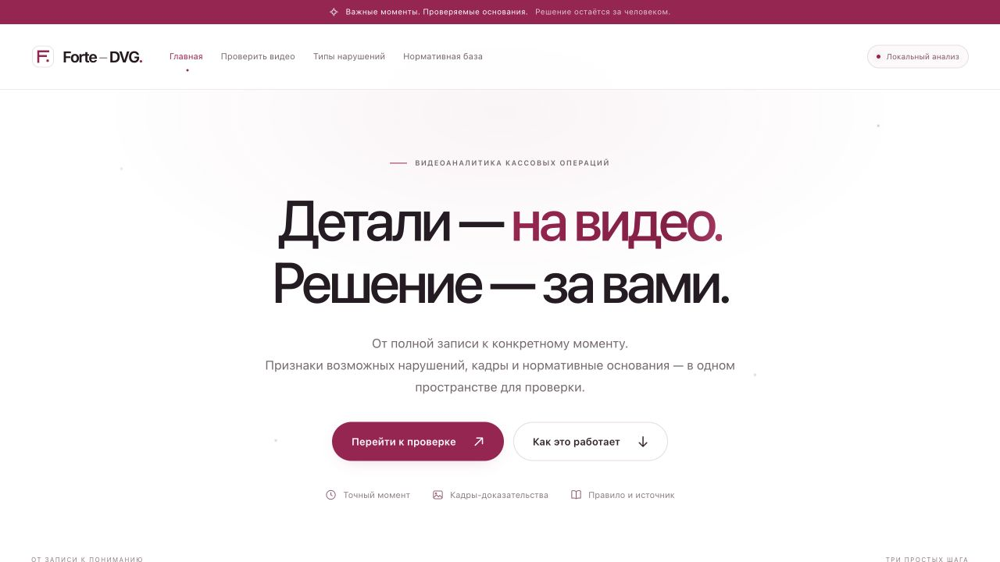
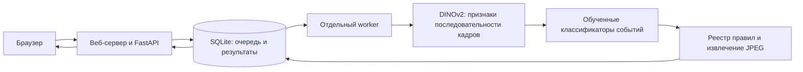

# Forte DVG

### От записи кассовой операции — к проверяемому событию

**Forte DVG** — веб-сервис для предварительной проверки видео работы кассира.
Он выделяет предполагаемые события и собирает рядом с записью всё, что нужно
проверяющему: таймкод, исходные кадры, описание и нормативный источник.

Проект разработан командой на **Datathon ’26 по кейсу ForteBank**.
Решение остаётся за человеком: результат сервиса не является юридическим
или дисциплинарным заключением.

**Python · FastAPI · SQLite · DINOv2 · ONNX Runtime · JavaScript**



[Быстрый запуск](#быстрый-запуск) · [Архитектура](#архитектура) · [Качество модели](#качество-модели) · [Документация](#документация)

## Как работает сервис

**Загрузить → дождаться обработки → проверить результат.**

1. Пользователь выбирает видео в формате MOV или MP4.
2. Backend создаёт задание, а отдельный worker выполняет локальный анализ.
3. Интерфейс показывает вердикт и найденные события рядом с видеоплеером.

| В результате | Для чего это нужно |
|---|---|
| Вердикт `no_violation` или `violation` | Быстро перейти к записям, требующим внимания |
| Несколько событий в одном видео | Рассмотреть каждую ситуацию отдельно |
| Тип, описание и время в секундах | Перейти к соответствующему моменту записи |
| 1–3 исходных JPEG-кадра для события | Проверить вывод по самому видео |
| Документ, пункт и ссылка на источник | Проследить нормативное основание и условия его применения |

Интерфейс поддерживает перемотку к событию и увеличение кадров. Ошибка обработки
показывается отдельно и не превращается в вывод об отсутствии нарушений.

## Архитектура



- **Frontend:** HTML, CSS и JavaScript; белая основа, бордовые акценты,
  адаптивные карточки и видеоплеер. Стили и ресурсы хранятся в проекте.
- **Backend:** FastAPI, защищённый API, SQLite-очередь, отдельный процесс
  обработки и ограничение времени задания. Ключ API хранится на сервере.
- **ML:** замороженный DINOv2 извлекает визуальные признаки 12 последовательных
  кадров и их областей. Временные признаки поступают обученным RBF kernel-ridge
  классификаторам, которые предлагают вердикт, категории и время события.
- **Доказательства:** backend извлекает реальные кадры из загруженной записи.
  Нормативные ссылки берутся из реестра, а не генерируются языковой моделью.

Анализ выполняется на CPU, без внешних AI API. Runtime получает видео;
подстановок ответов по имени файла, номеру ролика или хешу нет.

## Быстрый запуск

Нужны **Python 3.12**, Git и локальные ресурсы модели. Запуск проверен на
macOS Apple Silicon. Команды PowerShell приведены ниже; полный прогон на
Windows отдельно не подтверждён.

### 1. Клонировать и установить зависимости

macOS / Linux:

```bash
git clone https://github.com/dkalidolda-create/forte-dvg.git
cd forte-dvg
python3.12 -m venv .venv
.venv/bin/python -m pip install -r requirements-runtime.txt
```

Windows PowerShell, если `python --version` показывает Python 3.12:

```powershell
git clone https://github.com/dkalidolda-create/forte-dvg.git
cd forte-dvg
python -m venv .venv
.\.venv\Scripts\python.exe -m pip install -r requirements-runtime.txt
```

Все следующие команды выполняются **из корня проекта**. Если копия и окружение
уже существуют, повторно создавать их не нужно. Активация окружения необязательна.

### 2. Разместить локальные ресурсы модели

Банковские видео, разметка и обученные веса не публикуются в GitHub.
Для настоящего анализа требуется отдельно предоставленный командой комплект:

```text
artifacts/models/
├── dinov2-small-onnx/
│   ├── model.onnx
│   └── preprocessor_config.json
└── temporal-events-review-v3/
    └── model.npz
```

Публичный энкодер: `Xenova/dinov2-small`; сведения о версии и лицензии —
в [документации модели](docs/ML_RUNTIME.md#происхождение-энкодера).
Обученная голова предоставляется отдельно с учётом правил доступа к данным.
Без этих ресурсов можно изучить интерфейс и выполнить тесты, но получить
реальный результат анализа не получится.

### 3. Настроить `.env`

Скопируйте `.env.example` в `.env`, **если своего `.env` ещё нет**.
Сгенерируйте ключ командой и внесите его в `API_KEY`:

```bash
.venv/bin/python -c "import secrets; print(secrets.token_urlsafe(32))"
```

На Windows используйте `.\.venv\Scripts\python.exe` вместо `.venv/bin/python`.
Основные настройки:

```dotenv
API_KEY=replace-with-your-generated-key
ANALYZER_PATH=ml.temporal_inference:analyze
STORAGE_ROOT=data/runtime
JOB_TIMEOUT_SEC=270
MAX_UPLOAD_MB=100
MAX_PENDING_JOBS=8
```

Файл `.env` и ключ не должны попадать в Git. UI передаёт ключ на стороне сервера,
не встраивая его в браузерный JavaScript.

### 4. Запустить два процесса

Терминал 1 — единый веб-сервер с интерфейсом и API:

```bash
.venv/bin/python -m uvicorn backend.public:app --host 127.0.0.1 --port 9000
```

Терминал 2 — обработчик заданий:

```bash
.venv/bin/python -m backend.worker
```

На Windows в обеих командах замените `.venv/bin/python` на
`.\.venv\Scripts\python.exe`.

**Открыть сайт: http://127.0.0.1:9000 · Swagger: http://127.0.0.1:9000/docs**

Оставляйте оба процесса работающими. По умолчанию gateway использует порт 9000;
при его изменении задайте соответствующий `PUBLIC_PORT` в окружении.
Дополнительный API-сервер на 8000 для этого режима не нужен.

Для доступа с другого компьютера нужен размещённый сервер или HTTPS-туннель.
Туннель зависит от включённого локального компьютера и не заменяет постоянный
хостинг. [Подробности запуска и развёртывания](docs/BACKEND.md).

## API

| Метод и маршрут | Назначение |
|---|---|
| `POST /api/v1/analyze` | Загрузить видео: multipart-поле `file`, заголовок `X-API-Key` |
| `GET /api/v1/jobs/{job_id}` | Получить состояние и результат задания с тем же ключом |
| `GET /health` | Проверить доступность API; готовность модели этим не подтверждается |

После загрузки API возвращает **HTTP 202**:

```json
{"job_id": "<uuid>", "status": "processing"}
```

Клиент опрашивает задание до `done` или `failed`. Завершённый результат содержит
`verdict`, список `violations`, `timecode_sec` и кадры `image_base64` с
`timestamp_sec`. В Swagger ключ вводится через **Authorize**, без `API_KEY=`
и без `Bearer`.

[Полный контракт API](contracts/api.md)

## Качество модели

Это исследовательский прототип на небольшой выборке одного ракурса.
В разметке 42 файла, из них **40 уникальных видео**.

| Проверка | Результат |
|---|---|
| Повторная обработка обучающих файлов настоящим pipeline | 42/42: совпали вердикты и наборы категорий |
| Предварительная отложенная проверка до обучения на всей выборке | 2/8 правильных вердиктов; 1/8 точных наборов категорий |
| Автоматические проверки программной логики | 66 тестов |

**42/42 — совпадение на обучающих примерах, а не независимая accuracy.**
Перенос на новые камеры не подтверждён. Таймкоды получены со слабой разметкой:
при проверке нужно смотреть соседние секунды. Реестр включает 18 типов
наблюдений; наличие категории не означает доказанной надёжности её распознавания.

[Устройство модели, эксперименты и ограничения](docs/ML_RUNTIME.md)

## Нормативная привязка

В проекте используется цепочка: **источник → условие применения → наблюдаемое
событие → время и кадры**. Основные документы:

- [Правила осуществления кассовых операций и инкассации, №231](https://adilet.zan.kz/rus/docs/V1900019680).
- [Правила организации охраны и устройства помещений, №14](https://adilet.zan.kz/rus/docs/V2000020075).

Для 11 категорий указана условная нормативная связь, для 7 — только контекст
для проверки. Наблюдаемое действие само по себе не всегда доказывает нарушение:
применимость нормы и обстоятельства проверяет человек.

[Сопоставление событий и источников](docs/NORMATIVE_MAPPING.md) ·
[Все типы наблюдений](docs/SUPPORTED_EVENTS.md)

## Проверки

```bash
.venv/bin/python -m unittest discover -s tests -t .
```

Тесты используют временные данные, синтетические видео и тестовые адаптеры;
банковские записи и обученные веса для них не нужны. Проверяются авторизация,
загрузка, ограничения запроса, очередь, таймауты, кадры, UI и контракты модели.

По умолчанию: **100 МиБ на файл**, **8 незавершённых заданий**, **270 секунд**
с момента принятия задания. Worker обрабатывает одно видео за раз.
Автоматическое удаление загруженных записей пока не реализовано: для эксплуатации
нужны согласованный срок хранения и очистка. Локальная обработка модели
не отменяет передачи файла серверу при удалённой загрузке.

## Структура проекта

```text
backend/               API, очередь, worker и извлечение кадров
frontend/              Веб-интерфейс и серверный gateway
ml/                    Визуальные признаки, классификаторы, обучение и оценка
contracts/             Контракт API
docs/                  Архитектура, запуск, нормативная база и эксперименты
tests/                 Автоматические проверки
```

## Документация

- [Backend и запуск](docs/BACKEND.md)
- [Веб-интерфейс](docs/FRONTEND.md)
- [Текущая ML-модель](docs/ML_RUNTIME.md)
- [Нормативные источники](docs/NORMATIVE_MAPPING.md)
- [Категории событий](docs/SUPPORTED_EVENTS.md)
- [Контракт API](contracts/api.md)

В репозитории находятся исходники и документация. Видео, Excel-разметка,
кадры банковских записей, локальные базы, журналы, ключи и веса исключены из Git.
